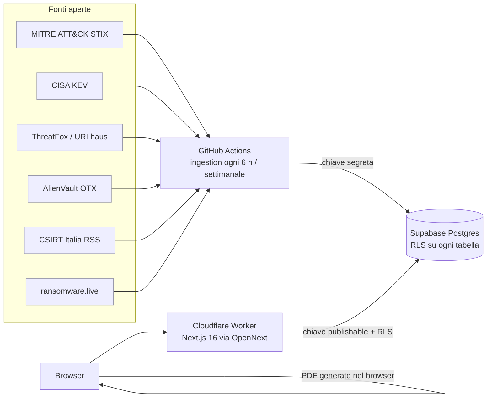

# ThreatBrief

**Piattaforma di Cyber Threat Intelligence per i settori italiani: dalle fonti aperte al brief per il management, con un flusso verificabile.**

> *EN — ThreatBrief is a CTI portfolio project focused on Italian organisations. It collects open-source threat data (MITRE ATT&CK, MITRE D3FEND, CISA KEV, abuse.ch, CSIRT Italia, ransomware.live), profiles the most active threat actors with ATT&CK techniques and D3FEND countermeasures, links mitigations to the NIS2 measures (Italian Legislative Decree 138/2024, art. 24), and publishes intelligence with TLP 2.0, Admiralty grading, facts separated from judgements, PDF, STIX 2.1 and a read-only TAXII 2.1 server.*

**Demo pubblica:** https://threatbrief.salvo-bonavita9808.workers.dev — senza account. Per chi valuta: parti da [**Cosa dimostra**](https://threatbrief.salvo-bonavita9808.workers.dev/competenze), che collega ogni requisito degli annunci CTI alla pagina che lo dimostra.

---

## Cinque sezioni, ognuna risponde a un requisito degli annunci CTI

| Sezione | Cosa fa | Requisito |
|---|---|---|
| **Briefing** (home) | I punti più importanti del periodo per un'organizzazione italiana: cosa è successo, perché conta, cosa fare. Nasce da una bozza automatica giornaliera (KEV, CSIRT Italia, rivendicazioni, IOC) rivista dall'analista e pubblicata come TLP:CLEAR, massimo 5 punti. | Riassunti giornalieri e settimanali; comunicazione a tutti i livelli |
| **Minacce** | Classifica dei gruppi ransomware più attivi contro organizzazioni italiane e schede in italiano (come entrano, strumenti, tecniche ATT&CK per fase, contromisure specifiche e prioritarie, **contromisure MITRE D3FEND**), solo da fonti primarie. Profili di tutti gli attori ATT&CK e confronto tra due attori. **La notte nel mondo**: rapporto automatico ogni mattina sulle ultime 24 ore (rivendicazioni, malware, nuove KEV), con le tecniche ricorrenti degli attori attivi e le difese ATT&CK/D3FEND che ne coprono di più. **Difesa e aerospazio**: rileva negli avvisi ufficiali CISA e partner quelli sulla filiera della difesa e prepara da solo una bozza di report (fatti con fonte, tecniche, CVE sfruttate, azioni, D3FEND) che l'analista rivede e pubblica. | MITRE ATT&CK e D3FEND; analisi delle TTP |
| **Settori** | Per ogni settore: attori, tecniche più usate, mitigazioni prioritarie collegate alle misure NIS2 (art. 24 D.Lgs. 138/2024), rivendicazioni. | Tradurre la minaccia in rischio e azioni |
| **Analizza** | Triage di un testo o di una lista di IOC (anche defanged): nuovo, già visto o collegato a malware e attori; CVE nel catalogo KEV; tecniche citate. | Triage degli IOC; correlazione di più fonti |
| **Report** | Brief esecutivo di una pagina e scheda tecnica; export PDF e **STIX 2.1**; i report pubblicati sono anche su un **server TAXII 2.1** (`/taxii2/`) consumabile da OpenCTI o MISP. | Report utilizzabili; STIX/TAXII |

Dietro le quinte: raccolta automatica su GitHub Actions (feed ogni 6 ore, ATT&CK e D3FEND ogni settimana, rapporto della notte e digest ogni mattina), pagina [Fonti](https://threatbrief.salvo-bonavita9808.workers.dev/fonti) con lo stato di ogni fonte.

**Area personale** (solo per l'analista, dopo l'accesso): digest giornaliero da rivedere, editor dei report, **Accademia** (12 lezioni sul mestiere CTI con domande da colloquio e allenamento a schede) e **Sul campo** (giornata tipo e 8 casi pratici).

## Rigore analitico (la parte che conta)

- **TLP 2.0** su ogni report, con le etichette ufficiali FIRST. Il DB impedisce di pubblicare qualsiasi cosa diversa da TLP:CLEAR, e nello STIX i marking usano gli identificativi OASIS ufficiali.
- **Fatti separati dalle valutazioni**, già a livello di schema: un fatto senza fonte o una valutazione senza livello di confidenza vengono rifiutati dal database.
- **Codice Admiralty** (affidabilità A–F, credibilità 1–6) per ogni fonte di un report.
- **Niente dati inventati spacciati per reali.** I contenuti dimostrativi sono marcati *ESEMPIO* ovunque (UI, PDF, RSS, STIX). I tre report di esempio citano fonti reali e calcolano i numeri dal DB.
- **Le derivazioni automatiche sono dichiarate come tali**: un attributo estratto da un testo ha confidenza bassa e mostra la frase da cui viene. Gli errori ricorrenti dell'estrazione (frasi di attribuzione, arresti, "outside of X"…) sono coperti dai test.
- **La mappatura ATT&CK → NIS2** è un file JSON versionato ([`data/nis2-mapping.json`](data/nis2-mapping.json)) con il testo ufficiale dell'art. 24 e una motivazione per ogni voce. È dichiarata come *valutazione del progetto*, non come tabella ACN.
- **Il brief esecutivo sta in una pagina**: i limiti di lunghezza sono applicati dall'editor e un test genera il PDF con tutti i campi al massimo e verifica che sia di una pagina.

## Architettura



- **Ingestion su GitHub Actions e non su Cloudflare Cron**: il bundle STIX di ATT&CK pesa circa 55 MB e richiede circa 300 MB di RAM per il parsing, mentre un Worker del piano gratuito ha 128 MB di memoria e 10 ms di CPU.
- **Il Worker non conosce nessun segreto.** Usa solo la chiave *publishable*, e cosa può leggere o scrivere lo decide la RLS di Postgres. La chiave segreta vive solo nei secrets di GitHub Actions. Uno script ([`scripts/verify-worker-env.mjs`](scripts/verify-worker-env.mjs)) blocca il deploy se nel bundle finisce una variabile non `NEXT_PUBLIC_*`: OpenNext copia i file `.env` nel Worker, ed è così che il problema è emerso durante lo sviluppo.

## Sicurezza

- **RLS attiva su tutte le tabelle.**
  - Dati di riferimento: leggibili da tutti.
  - Report: leggibili da tutti solo se `published` e TLP:CLEAR; bozze e report non CLEAR solo dal proprietario.
  - Analisi salvate: private.
  - Tabelle figlie dei report: seguono la visibilità del report padre.
- **Scrittura riservata agli analisti** (tabella `analysts`, registrazioni chiuse). La funzione di controllo vive in uno schema non esposto (`private.is_analyst()`). Le funzioni `SECURITY DEFINER` dell'ingestion sono eseguibili solo da `service_role`.
- **Server Actions**: ogni scrittura ricontrolla l'utente e passa comunque dalla RLS. I risultati delle analisi vengono ricalcolati sul server e non presi dal browser.
- **Messaggi d'errore delle fonti** (visibili pubblicamente nella pagina Fonti): ripuliti da chiavi e token prima di essere salvati.
- **Leak site ransomware**: gli indirizzi `.onion` non vengono né salvati né mostrati.

## Fonti dati

| Fonte | Contenuto | Frequenza | Chiave |
|---|---|---|---|
| MITRE ATT&CK Enterprise (STIX 2.1) | tattiche, tecniche, gruppi, software, mitigazioni | settimanale | no |
| MITRE D3FEND (API) | contromisure difensive per ogni tecnica ATT&CK | settimanale | no |
| CISA KEV | vulnerabilità sfruttate attivamente | 6 h | no |
| CISA Cybersecurity Advisories (RSS) | avvisi congiunti CISA/FBI/NSA e agenzie alleate, testo completo | 6 h | no |
| abuse.ch ThreatFox, URLhaus | IOC (IP, domini, URL, hash) | 6 h | sì, gratuita |
| AlienVault OTX | pulse, solo TLP:CLEAR/WHITE | 6 h | sì, gratuita (facoltativa) |
| CSIRT Italia / ACN | alert e bollettini (RSS) | 6 h | no |
| ransomware.live | rivendicazioni contro vittime italiane (non verificate) | 6 h | no |

MITRE ATT&CK® è riprodotto secondo i [termini d'uso](https://attack.mitre.org/resources/legal-and-branding/terms-of-use/) di The MITRE Corporation.

## Stack

Next.js 16 (App Router, Server Actions) · TypeScript · Tailwind CSS 4 · Supabase (Postgres, Auth, RLS) · Cloudflare Workers con `@opennextjs/cloudflare` · Recharts · `@react-pdf/renderer` · Vitest · GitHub Actions.

## Avvio in locale

```bash
npm install
cp .env.example .env.local          # URL e chiave publishable Supabase
cp .env.ingest.example .env.ingest  # chiave segreta e chiavi API: solo per gli script di ingestion
npm run ingest -- attack feeds      # popola il DB (ATT&CK + tutti i feed)
npm run seed:examples               # report di esempio
npm run dev
```

Altri comandi:

```bash
npm test && npm run typecheck && npm run lint
npm run preview   # build Cloudflare + Worker locale (workerd)
npm run deploy    # build, controllo del bundle, deploy su Cloudflare
```

Lo schema del database è in [`supabase/migrations/`](supabase/migrations/). Le note di ogni fase di sviluppo, con le scelte fatte e i limiti noti, sono in [`docs/`](docs/).

## Scelte tecniche e limiti noti

- **Niente Cache Components su Cloudflare.** Con OpenNext 1.20 il rendering si blocca sul runtime dei Worker, quindi tutte le pagine sono dinamiche e leggono sempre dati aggiornati.
- **Niente proxy/middleware di Next.** In Next 16 gira solo su Node.js, che OpenNext non supporta ancora sui Worker. La sessione dell'analista si rinnova dal browser con il client ufficiale Supabase.
- **PDF generato nel browser**: nessun carico sul Worker e nessuna dipendenza WebAssembly lato server.
- **ThreatFox** a volte tronca le risposte lunghe lato server. L'ingestion tiene i record completi ricevuti e registra la raccolta come *parziale*, visibile nella pagina Fonti.
- **ransomware.live** non ha una categoria per le telecomunicazioni: per quel settore la dashboard mostra "n.d." invece di attribuire dati a caso.
- **Piano gratuito Cloudflare: 10 ms di CPU per richiesta.** Le pagine pubbliche sono servite da **Workers Cache** (30 minuti, poi aggiornamento in background), quindi una visita in cache non esegue il Worker e non consuma CPU. Il badge dell'account è calcolato nel browser, così le pagine in cache sono identiche per tutti; le pagine dell'analista non vengono mai messe in cache. Un report appena pubblicato compare su /briefs entro circa 30 minuti.
- **`npm audit` segnala 3 vulnerabilità moderate** in `glob`/`minimatch`, dipendenze della CLI di build di OpenNext che non finiscono nel Worker. La correzione proposta (downgrade a OpenNext 0.3) romperebbe il progetto.

---

Autore: _nome, ruolo e link_ · Progetto realizzato come portfolio per ruoli di Threat Intelligence Analyst.
